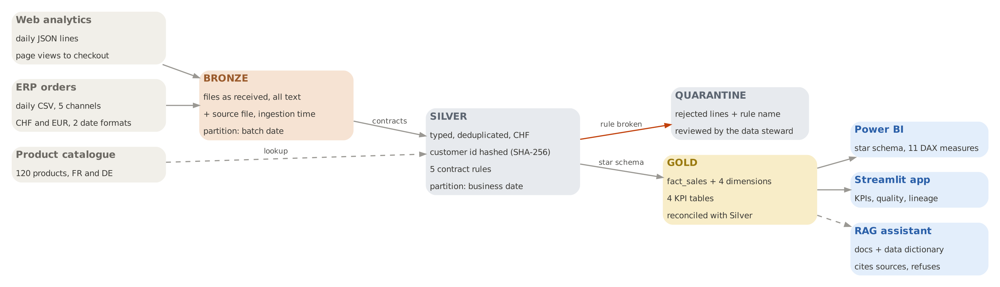
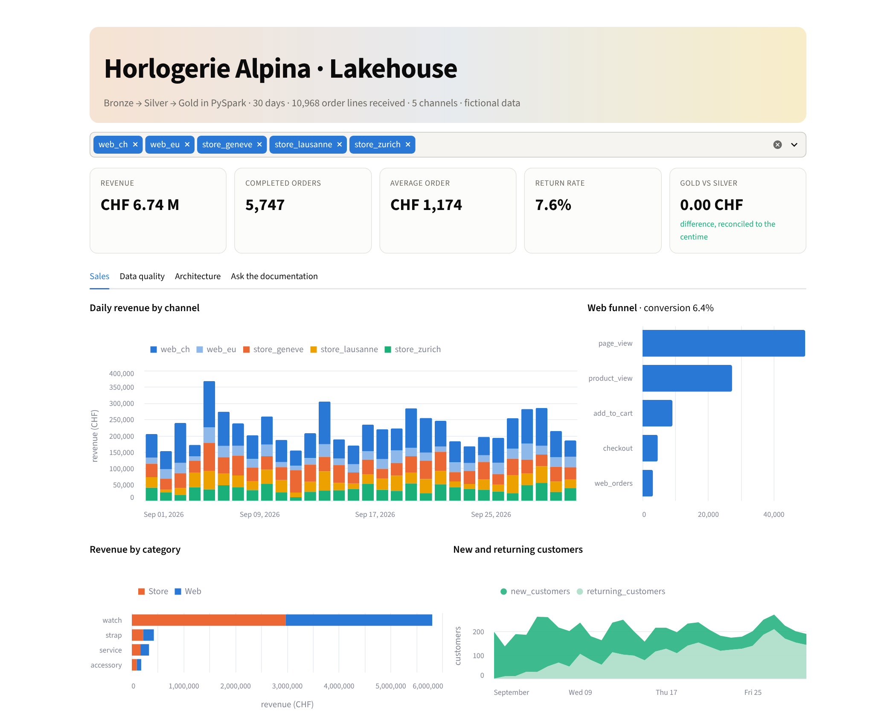
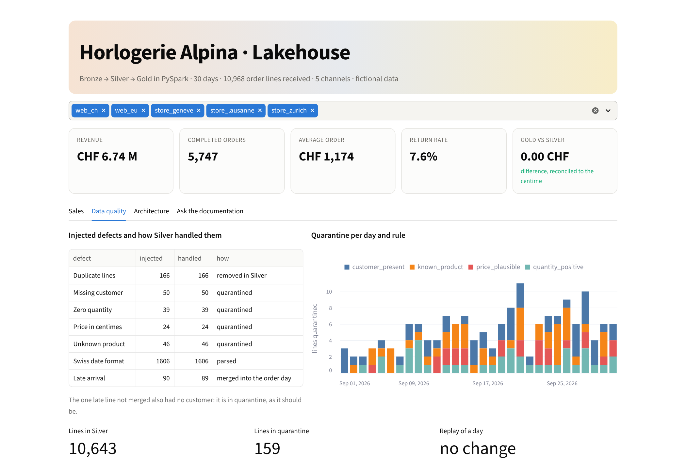
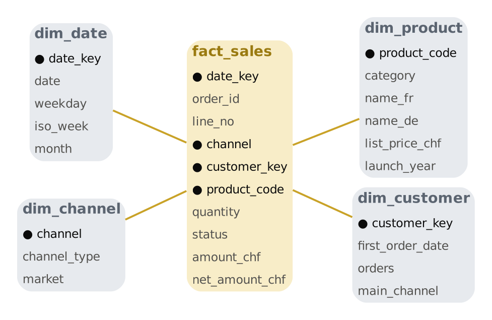
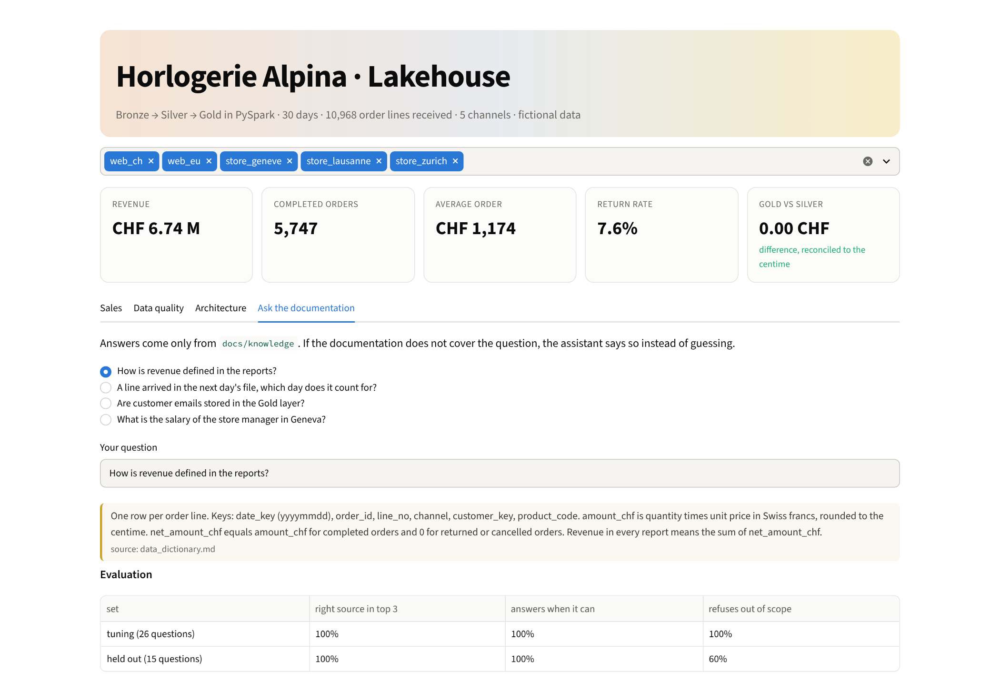

# medallion-lakehouse-lab

**A Bronze / Silver / Gold lakehouse in PySpark for a Swiss omnichannel retailer: data contracts, quarantine,
incremental and idempotent daily loads, a star schema with DAX measures for Power BI, a Streamlit front end, and a
documentation assistant (RAG) evaluated on a held-out set for whether it finds the right source and refuses what it
does not know.**

   



| 10,968 lines received | 100 % of injected defects handled | 0.00 CHF Gold vs Silver | 1 day replayed, 0 change |
|:---:|:---:|:---:|:---:|

## The case

"Horlogerie Alpina", a fictional watch brand, sells through a Swiss web shop, a European web shop (in euros) and
three stores in Geneva, Lausanne and Zurich. Every day the ERP drops an order file and the web analytics tool drops
an event file; a product catalogue is shared once. The data is synthetic, but it carries the defects real sources
have, each injected and counted so the pipeline can be scored against an answer key:

| Defect in the sources | Why it happens | What Silver does |
|---|---|---|
| a line sent twice | the ERP interface resends after a timeout | keeps the first one ingested |
| empty customer id | a guest checkout in store | quarantine, rule `customer_present` |
| quantity 0 | a till correction | quarantine, rule `quantity_positive` |
| price 100 times too high | a till sending centimes | quarantine, rule `price_plausible` |
| unknown product code | a code typed by hand | quarantine, rule `known_product` |
| date as `dd.mm.yyyy` | store tills use the Swiss format | parsed, both formats accepted |
| a line arriving one day late | the order was closed after the export | merged into the day of the order |

## The app

`streamlit run app.py` opens a front end on the Gold layer: sales, data quality, architecture and the assistant.





## Architecture

| Layer | What it holds | Where |
|---|---|---|
| Landing | files as delivered | `work/landing/` (written by [`generate.py`](lakehouse/generate.py)) |
| Bronze | every column as text, plus source file, ingestion time and batch date; one partition per batch | [`pipeline.py`](lakehouse/pipeline.py) `bronze()` |
| Silver | typed, deduplicated, both date formats parsed, euros converted to francs, customer id hashed (SHA-256), email dropped; five contract rules, failures go to a quarantine table with the rule name; partitioned by **business date** | `silver()` and [`contracts.yaml`](lakehouse/contracts.yaml) |
| Gold | star schema and four KPI tables: daily revenue per channel, web funnel, category per month, new and returning customers | `gold()` |
| Observability | one row per day: lines received, duplicates, quarantine by rule, late lines merged | `powerbi/export/dq_daily.csv` |
| Serving | Gold as CSV, DAX measures, Streamlit app | [`powerbi/`](powerbi), [`app.py`](app.py) |
| Orchestration | Databricks Asset Bundle: three notebook tasks, daily at 06:00 Europe/Zurich | [`databricks/`](databricks) |
| Documentation assistant | retrieval over the data dictionary and policies, answers with sources, refusal | [`rag.py`](lakehouse/rag.py), [`eval/`](eval) |

Every write overwrites only the partitions it touches (dynamic partition overwrite), so replaying a day is safe.
The diagrams are generated from code ([`diagrams.py`](lakehouse/diagrams.py)).



## Results (30 days)

* **Every injected defect is handled**: 166 duplicates removed; 50 missing customers, 39 zero quantities,
  24 prices in centimes and 46 unknown products quarantined with the rule they broke; 1,606 Swiss-format timestamps
  parsed. 89 of 90 late lines are merged into their order day; the 90th also had no customer and sits in quarantine,
  which is the expected behaviour.
* **Every row is accounted for**: 10,968 Bronze lines = 10,643 in Silver + 166 duplicates + 159 in quarantine.
* **Gold reconciles with Silver to the centime**: completed revenue CHF 6,744,481.73 in both.
* **Replaying a day changes nothing**: the 6 September load was run a second time, Gold revenue per day is identical.
* **KPIs**: average order CHF 1,174, return rate 7.6 %, web conversion 6.4 % of sessions with a page view; watches
  make most of the revenue, in stores and on the web alike.

## Documentation assistant

The assistant answers only from [`docs/knowledge`](docs/knowledge) (data dictionary, quality policy, personal data
and access, currency and calendar, operations). It retrieves paragraphs with TF-IDF and refuses when the best passage
is too far from the question or when less than half of the question's words appear in what it retrieved.



| Question set | Right source in the top 3 | Answers when it can | Refuses out of scope |
|---|---:|---:|---:|
| tuning set, 26 questions (thresholds chosen on it) | 100 % | 100 % | 100 % |
| **held-out set, 15 questions written afterwards** | **100 %** | **100 %** | **60 %** |

The held-out set is the honest number. Retrieval transfers well; refusal does not: "What is the price of the Alpina
Heritage 40 mm watch?" and "What is the average delivery time to Germany?" share enough words with the documentation
to pass the guard, and the assistant answers with an unrelated passage. Two lessons: a lexical guard alone cannot
judge whether a passage answers a question, and thresholds tuned on one set look better than they are. The next step
is to let a model judge the passage (the code already supports an OpenAI-compatible endpoint, such as an Azure OpenAI
or Microsoft Foundry deployment, with a fixed refusal sentence) and to measure it on the same held-out set.

## Power BI

`powerbi/export/` holds the Gold tables as CSV. [`measures.dax`](powerbi/measures.dax) lists the relationships and 11
measures: revenue, orders, average order value, return rate, week over week, month to date, store share, new
customers, product rank and web conversion.

## Run

```bash
pip install -r requirements.txt    # Java 17 or 21 for Spark
pytest -q                          # 9 tests on 4 generated days, about 40 s
python run.py                      # 30 days end to end, Power BI export, results/summary.json
streamlit run app.py               # the front end
```

## Limits

* Synthetic data from a fictional company; the defects are realistic but chosen, so a 100 % catch rate shows the rules
  work, not that they would catch everything in a real ERP.
* Run locally on Spark with Parquet. On Databricks the same functions would write Delta tables and use `MERGE INTO`
  instead of a partition overwrite; the bundle in `databricks/` was not deployed.
* No Azure resources were used: Azure Data Factory or Event Grid would land the files, and Unity Catalog would hold
  the grants described in [`privacy_and_access.md`](docs/knowledge/privacy_and_access.md).
* The euro is converted at a fixed planning rate, as stated in the documentation.

## License

MIT
